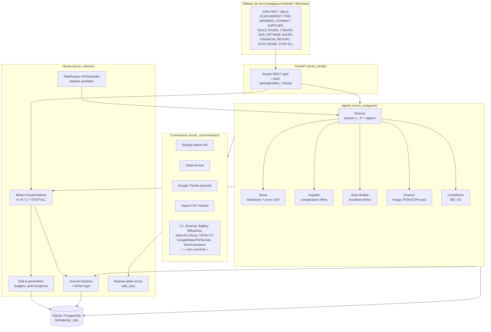

# Architecture d'Ecom-OS (MVP)

Ecom-OS est un « système d'exploitation e-commerce » supervisé : des agents spécialisés
partagent un **état central** (base de données), passent tous par un **moteur d'autorisations**
(niveaux A/B/C + STOP ALL) et écrivent chaque décision dans un **journal d'actions**.

## Modules

| Dossier | Rôle |
|---|---|
| `ecom_os/models.py` | Tables : products (scores 0-100 par critère), suppliers, offers, stores, product_drafts, tasks, approvals, action_log, settings |
| `ecom_os/core/permissions.py` | Niveaux A/B/C, approbations, budgets, STOP ALL. Action inconnue ⇒ niveau C |
| `ecom_os/core/state.py` | Paramètres (arrêt d'urgence, AUTO MODE, budgets à 0 € par défaut, TVA, frais de paiement) |
| `ecom_os/core/logs.py` | Journal en base + fichier `logs/ecom_os.log` (rotation) |
| `ecom_os/core/retry.py` | Nouvelles tentatives avec backoff exponentiel ; « non connecté » n'est jamais retenté |
| `ecom_os/core/scheduler.py` | Pipeline quotidien (Europe/Brussels) exécuté seulement si AUTO MODE actif et STOP ALL inactif |
| `ecom_os/agents/*` | Scout, Supplier, Store Builder, Finance, Compliance, Director |
| `ecom_os/connectors/*` | Shopify, Stripe, Google Trends (réels) ; autres = interfaces « non connecté » ; import CSV |
| `ecom_os/api/main.py` | API REST + service du tableau de bord |
| `ecom_os/dashboard/static` | Interface web responsive, sans dépendance payante |

## Niveaux d'autorisation

| Niveau | Exemples | Règle |
|---|---|---|
| A | recherche, scoring, comparaison, brouillons, rapports | Autonome, aucune dépense |
| B | publier un produit (en brouillon Shopify), stock, pages, posts organiques | Seulement si `level_b_enabled = true` |
| C | pub payante, achat fournisseur, paiement, contrat, coordonnées bancaires, changement de prix > 10 %, remboursement, suppression définitive, 1er lancement public | Crée une approbation en attente ; exécution uniquement avec une approbation `approuve` correspondante, utilisable une seule fois ; montants plafonnés par les budgets (0 € par défaut) |
| STOP ALL | — | Bloque toute nouvelle action (A, B, C), désactive AUTO MODE, suspend les tâches |

## Score produit (/100)

Demande 25 · Marge 20 · Concurrence 15 · Fiabilité fournisseur 15 · Logistique 15 · Marketing 10.
Un critère sans donnée reste vide. Le total n'est calculé que si ≥ 5 critères sont connus, dont la
demande et la marge ; sinon « données insuffisantes ». Shortlist à partir de 65/100.

## Pipeline quotidien (Director)

1 tendances → 2 fournisseurs → 3 sélection → 4 fiches → 5 contenu (non disponible dans le MVP) →
6 ventes (connecteurs réels uniquement) → 7 anomalies → 8 optimisations (via autorisations) → 9 rapport
(exécuté / préparé / validation requise / non connecté / bloqué / erreurs / dépenses / priorités).
